# ZeroTracker

A music tracker for the [M5Stack CardputerZero](https://github.com/CardputerZero). It reads and
writes M8 song and instrument files, so a song can move between ZeroTracker and an M8.

| | | |
|---|---|---|
| 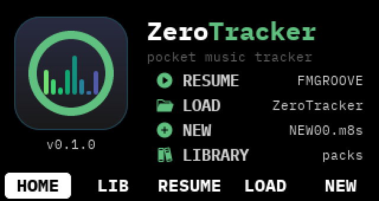 | 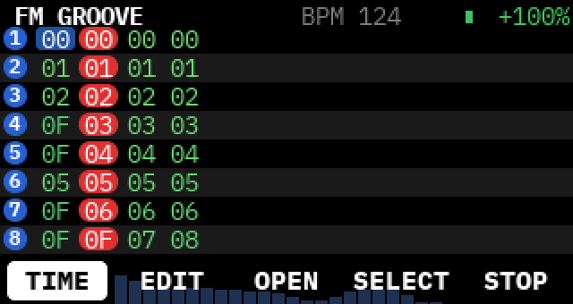 | 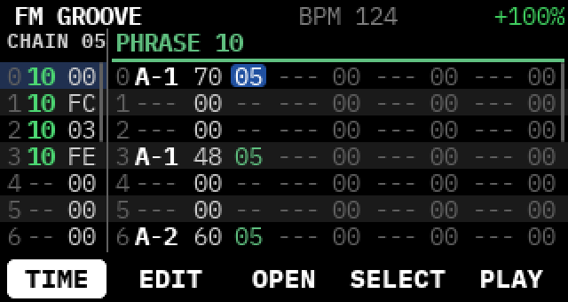 |
| HOME | TIME: the song as eight lanes | CHAIN and PHRASE side by side |
| 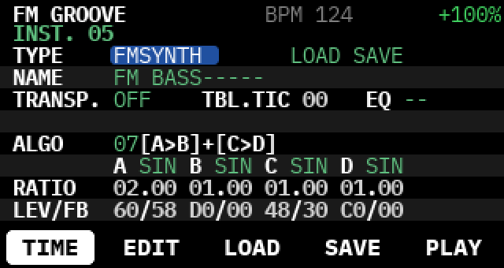 | 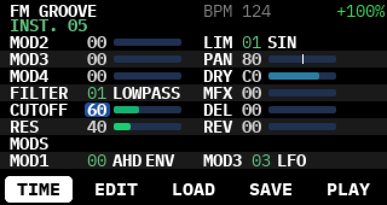 | 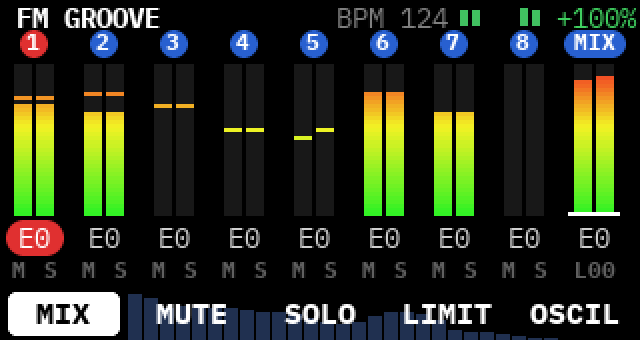 |
| an FM instrument | filter, mixer and modulators | MIX with meters |
| 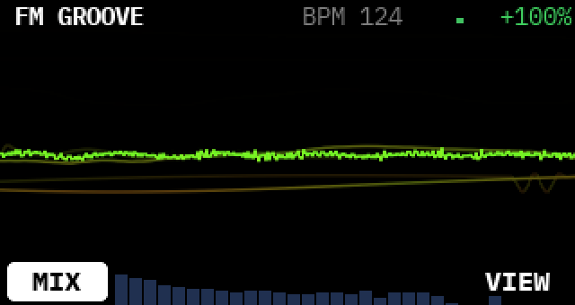 | 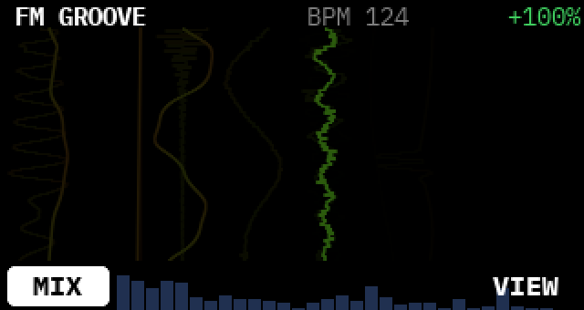 | 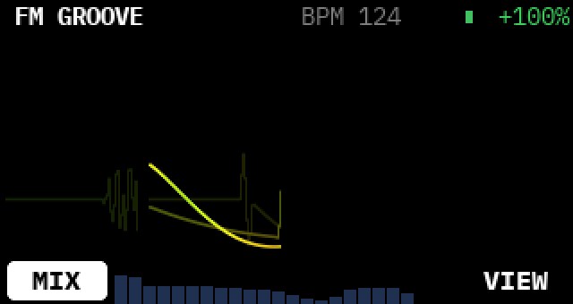 |
| oscilloscopes: lanes | columns | grid |
| 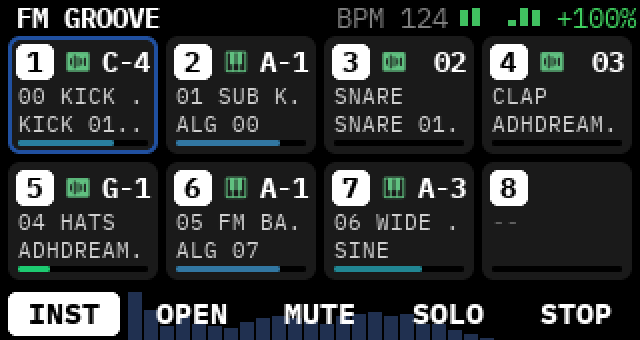 | 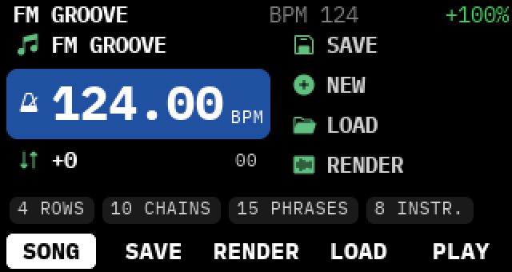 | 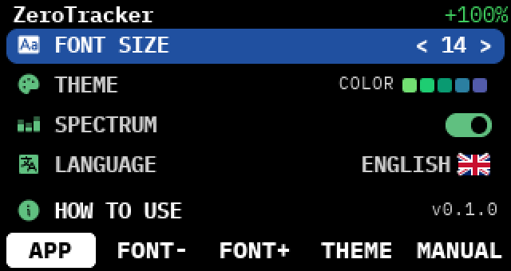 |
| INST: what each track plays | SONG | APP settings |
| 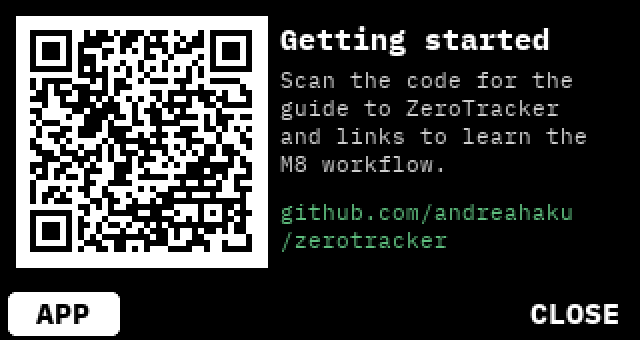 | 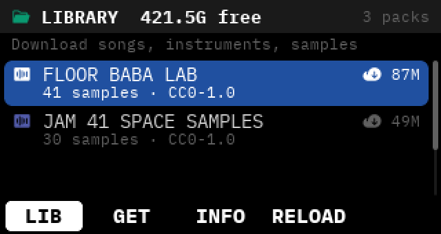 | 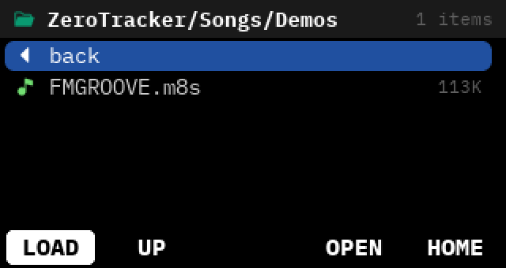 |
| MANUAL: a QR code to this guide | LIBRARY | LOAD |

- Eight tracks, songs, chains, phrases, instruments and tables, as on the M8.
- Synth engines: FMSYNTH, WAVSYNTH, MACROSYNTH (Braids models), HYPERSYNTH, and the SAMPLER with
  slices and a sample editor that records from the microphone.
- Mixer with chorus, delay, reverb, per-instrument EQ and a master limiter.
- RENDER to WAV: the mix and a stem per track.
- LIBRARY: download packs of songs, instruments and samples on the device.
- Keyboard-first UI for the CardputerZero, in seven languages.

Getting started: [docs/manual](docs/manual/README.md). Learning resources for the M8 workflow:
[docs/manual/resources.md](docs/manual/resources.md).

## Inspired by the M8

ZeroTracker is inspired by the excellent [M8 tracker](https://dirtywave.com) by Dirtywave. We
are M8 users and fans. That is why ZeroTracker opens and saves M8 song (`.m8s`) and instrument
(`.m8i`) files, and why most of its workflow (song, chain, phrase, instrument, table) follows
the M8. Files move between the two without losing data; how they sound can differ (see below).

ZeroTracker is an independent project. It is not affiliated with, endorsed by or supported by
Dirtywave. M8 is Dirtywave's product and trademark. ZeroTracker uses the name only to describe
file compatibility.

## How it was built

No Dirtywave code was used. No M8 firmware was disassembled or decompiled.
It contains no Dirtywave data, samples, wavetables, fonts or graphics.

Everything in ZeroTracker comes from analysis and comparison:

- **File format.** The `.m8s` and `.m8i` reader and writer start from
  [m8-file-parser](https://github.com/Twinside/m8-file-parser) (MIT), the community's
  open-source parser. We extended it by saving files and comparing the bytes.
- **Sound.** The synth engines are our own code. Each one plays the same test songs on the M8
  and on ZeroTracker. We render both, then compare the audio by level, frequency bands and
  timing, one track at a time. Then we change our code until the measurements match. The M8's
  sound is a target to listen to, not code to copy.
- **MACROSYNTH.** It uses the oscillator models of Mutable Instruments' Braids, open-sourced by
  Emilie Gillet under the MIT licence.
- **Workflow.** The screens follow the M8's concepts, redrawn for the CardputerZero's screen and
  keyboard.

Where we could not measure something, ZeroTracker does its own thing. An example: the M8's
wavetables are Dirtywave's data, so ZeroTracker uses generic waveforms for those slots.

## Why it does not sound exactly like an M8

Because ZeroTracker is built by listening and measuring, not from the M8's code, its sound is
close to the M8 but not identical. Your songs will play with the same notes, timing and
structure. Some sounds will differ:

- **Levels.** A track can be a little louder or quieter than on the M8. On our test songs the
  typical difference per track is about 1-2 dB.
- **Tone.** Filters at high resonance, distortion (limit modes), and the chorus, delay and
  reverb are our own designs. They are tuned toward the M8, so they sound similar but not the
  same.
- **WAVSYNTH wavetables.** These play generic waveforms, so those instruments sound
  different.
- **Fine details.** Envelope curves, modulation and the master limiter are measured
  approximations.

ZeroTracker is not a replacement for an M8. It is a pocket tracker that speaks the same
language. If something sounds clearly wrong to you, please open an issue with the song: every
report helps us get closer.

## Install

On a CardputerZero, download the `.deb` from the releases page and run:

```bash
sudo apt install ./ZeroTracker_*_arm64.deb
XDG_RUNTIME_DIR=/run/user/1000 systemctl --user restart APPLaunch.service
```

## Build

Rust (stable) and CMake on Linux. The device binary is built in a Debian trixie container
(Docker), so it matches the device's libraries.

```bash
scripts/fetch-fixtures.sh            # once: test files from m8-file-parser (MIT)
scripts/ci.sh                        # cargo fmt, clippy, test, and the desktop build
build/linux-x86-64/Release/zerotracker   # desktop simulator, 320x170
scripts/cp0-docker-build.sh --package    # device build and .deb in dist/
```

| Path | Content |
|---|---|
| `m8fmt/` | M8 file reader and writer (MIT, a fork of m8-file-parser) |
| `m8view/`, `m8edit/` | song views and editing commands |
| `engine/` | sequencer and synth engines, C API in `engine/include/` |
| `ffi/` | the static library the app links: navigation, samples, RENDER, LIBRARY |
| `src/` | the C++/LVGL app, from the CardputerZero Template |
| `docs/manual/` | getting started and resources |

## Contributing

Bug reports, songs that sound wrong, translations and code are welcome: see
[CONTRIBUTING.md](CONTRIBUTING.md), including the clean-room rules every contribution follows.

## Licence

ZeroTracker is free software under the GNU General Public License v3.0 or later
([LICENSE](LICENSE)). `m8fmt` keeps the MIT licence of m8-file-parser. Third-party code, fonts
and icons are listed in [NOTICE.md](NOTICE.md). The content that comes with the app keeps its
own licences, listed in `CONTENT.md` on the device.

## Support

ZeroTracker is free and open source. If it is useful to you, you can support its development with a one-off donation on [Ko-fi](https://ko-fi.com/andreahaku) or by sponsoring me on [GitHub Sponsors](https://github.com/sponsors/andreahaku). Donations are voluntary and do not unlock any feature. More in [FUNDING.md](FUNDING.md).

ZeroTracker is not affiliated with Dirtywave.
